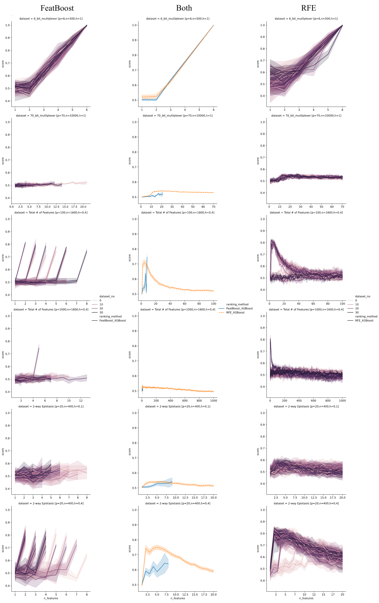
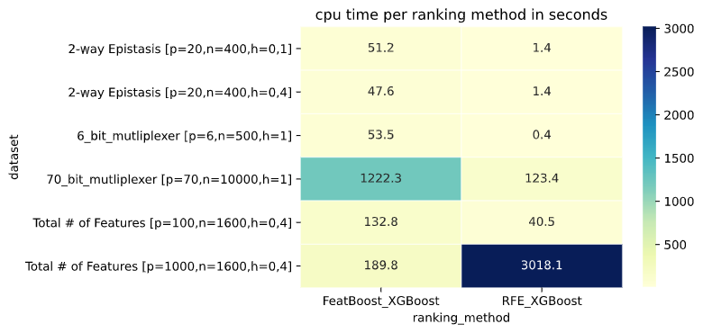
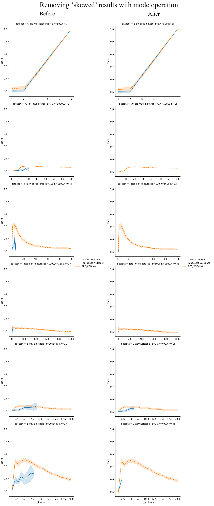

## Benchmark results
Benchmark results from 14th of May, 2020.

### Description
Benchmark was ran on RFE and FeatBoost, both using XGBoost as an estimator. Validation was done using a k-NN classifier with (`k = 1`).

Urbanowicz’s dataset repository contains 76 different datasets- some with a common theme but with different parameters, like #features, #samples or ‘heritability’ factor. For every dataset there exist 30 replicas. Some datasets had exceptionally high dimensionality (p=100000), and others were apparently difficult to compute, causing some computations to timeout at the 24hr mark. In total, I managed to test 23 datasets (or 690 separate datasets) on Peregrine, by submitting many multiple peregrine jobs at once, having each job compute results for a different dataset.

### Results

A subset of 6 chosen datasets, with an illustration of 'stability' and averaged results in the middle:

Timings for subset of 6:

Correction for 'skewed' results using mode operation:

... for more results check the `analyze-results.ipynb` Jupyter Notebook file ✌🏻